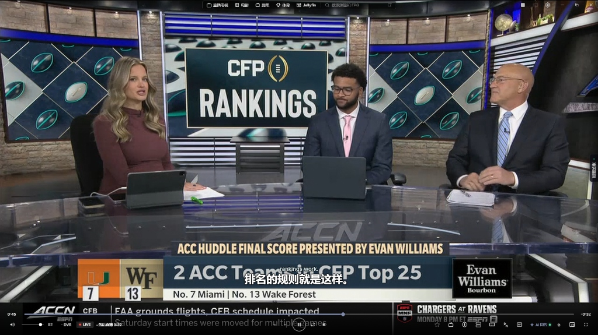
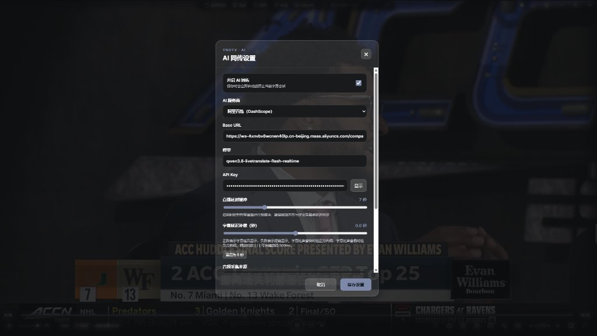

# ynoTV

[](https://tauri.app)
[](https://react.dev)
[](https://www.typescriptlang.org)
[](./LICENSE)
[](./README.md)

基于 [Tauri v2](https://tauri.app)、[React 19](https://react.dev) 与 [mpv](https://mpv.io) 构建的 Windows 开源桌面端 IPTV 播放器。本仓库在原版 [tbeezy/ynotv](https://github.com/tbeezy/ynotv) 基础上，深度新增了 **AI 实时延时同传字幕** 管线，支持外语直播流的超前音频采音、实时流式翻译与毫秒级双时钟字幕同步。

---

## 新增特性：AI 实时延时同传字幕

面向外语直播频道与无字幕直播流场景，内置完整的本地音频采音、AI 同传与透明悬浮字幕系统：

- **双模式音频采集与自动回退**
  - **超前探路模式（`auto_scout` / 默认优先）**：复用内置 FFmpeg Sidecar 在后台以纯音频方式超前拉取当前直播流（16kHz 单声道 PCM），默认超前蓄水 **5 秒**（支持 2–20 秒可调），实现画面与译文字幕的高精度同步。
  - **进程环回直采回退（`direct_tap`）**：当直播源存在单连接限制（Max Connections = 1）或探路器超时/失败时，自动切换至 Windows WASAPI 进程级环回直采，零额外网络连接、防踢线封号。
- **多模型与多路线同传引擎**
  - **阿里百炼 DashScope**：支持 `realtime` WebSocket 实时流式同传（默认模型 `qwen3.8-livetranslate-flash-realtime`，内置会话定时无缝刷新防断流）、`two_stage` 两步走（语音识别 + 文本翻译）以及 `multimodal` 多模态路线。
  - **OpenAI 兼容接口**：支持自定义 `baseUrl`、`apiKey` 与模型（兼容智谱 GLM、Gemini 等服务）。
- **双时钟对齐与实时控制**
  - **卡顿冻结保护**：播放器进入缓冲或手动暂停时自动冻结字幕推进时钟，防止字幕抢跑。
  - **毫秒级双向微调**：支持在 `-15000ms` 至 `+15000ms` 范围内实时调节字幕偏移，并支持流式打字机增量上屏、双语/仅译文切换与字体大小调节。
- **透明毛玻璃悬浮层**：基于 Tauri 透明窗口叠加层直接渲染在视频画面上方，支持全屏、小窗及画中画自适应。

| AI 实时双语同传效果 | AI 同传设置面板 |
| :-------------------------------------: | :--------------------------------------: |
|  |  |

### 已知问题与欢迎 PR（Known Issues & Contributing）

- **超前探路模式（`auto_scout`）偶发无法播放**：目前部分直播源在开启超前探路时可能出现拉流阻塞或画面无法正常恢复播放的情况。
  - **临时绕过方式**：在 **AI 同传设置** 中将音频采集来源切换为 **进程环回直采（`direct_tap`）**。
  - **欢迎协助定位与提交 PR**：核心调度与探路逻辑位于 [`audio_scout.rs`](./packages/app/src-tauri/src/ai_subtitle/audio_scout.rs)、[`controller.rs`](./packages/app/src-tauri/src/ai_subtitle/controller.rs) 与 [`lib.rs`](./packages/app/src-tauri/src/lib.rs)，欢迎在 Issues 中反馈复现日志或直接提交 Pull Request。

---

## 界面预览

| EPG 与实时预览 | VOD 点播库 |
| :-------------------------------------: | :--------------------------------------: |
|  |  |
| 播放列表编辑器 | EPG 编辑器 |
|  |  |
| 关注列表与自动切台 | Stremio 视图 |
|  |  |
| 体育赛事视图 | 主题系统 |
|  |  |
| 多视图菜单 | 画中画视图 |
|  |  |
| 2x2 四分屏 | DVR 录制管理 |
|  |  |

---

## 核心功能

- **多协议直播源与 EPG**：完整支持 M3U、Xtream Codes 与 Stalker 协议，支持多 EPG 节目单源。
- **生态服务集成**：支持 Stremio、Nuvio（双向同步）与 Jellyfin 媒体库接入，支持 Trakt 与 Simkl 观影记录同步、Discord 状态展示及 OpenSubtitles / SubSource 字幕下载。
- **网格 EPG 与实时预览**：内置透明浮层 EPG 节目单、预览窗口、分类文件夹、频道分组与 Logo 批量编辑。
- **回看、时移与自动容灾**：支持频道回看与缓存时移；支持死链/卡顿自动切换备用源、智能同名频道容灾聚类及备用 DNS/URL 自动切换。
- **多视图与画中画**：支持独立可调大小画中画（PiP）、最多 4 路同时播放的 2×2 网格视图，以及弹窗/外部播放器模式。
- **内置 DVR 与节目提醒**：支持手动或定时录制直播流；结合 TVMaze 节目日历自动设置开播提醒并自动切台。
- **本地媒体库与点播元数据**：支持扫描本地影视文件夹并自动匹配 TMDB 元数据与 RPDB 海报评分角标，保存观看进度。
- **体育赛事与局域网联动**：内置实时体育比分面板与球队频道绑定；支持投屏至局域网电视设备、手机扫码遥控及手柄空间导航。
- **高可定制性**：提供 40+ 内置主题、24 种界面语言及全自定义快捷键，支持流健康批量检测与导出修改后的 M3U 播放列表。

---

<details>
<summary>从源码构建（Building from Source）</summary>

## 从源码构建

### 环境要求

- **Node.js** 20.x 或更高版本
- **pnpm** 9.x（项目在 `package.json` 中指定 `pnpm@9.1.0`，可使用 `npm install -g pnpm` 安装或通过 `corepack` 启用）
- **Rust**（最新稳定版，可通过 [rustup](https://rustup.rs/) 安装）
- **Git**

**Windows 额外依赖：**
- [Microsoft Edge WebView2](https://developer.microsoft.com/en-us/microsoft-edge/webview2/)
- Visual Studio 2022（含 C++ 生成工具）
- Windows 10 SDK

### 构建步骤

**1. 克隆仓库**

```bash
git clone https://github.com/Roc0470/ynotv.git
cd ynotv
```

**2. 安装依赖**

```bash
pnpm install
```

**3. 准备运行库与 Sidecar（mpv / ffmpeg / yt-dlp / libmpv）**

`packages/app/src-tauri/bin/` 下需要包含 `mpv-x86_64-pc-windows-msvc.exe`、`ffmpeg-x86_64-pc-windows-msvc.exe` 与 `yt-dlp-x86_64-pc-windows-msvc.exe`，`packages/app/src-tauri/` 下需要 `libmpv-2.dll`、`vulkan-1.dll` 及 `VulkanRT-License.txt`：

```bash
bash scripts/download-mpv-tauri.sh
pnpm setup:libmpv
```

**4. 启动开发模式**

> 注意：请使用 `@ynotv/app` 的 Tauri 开发命令启动，避免直接在根目录并发拉起多个前端 dev 服务造成 `5173` 端口冲突。

```bash
pnpm --filter @ynotv/app tauri dev
```

**5. 常用静态检查与生产构建**

```bash
# 前端类型与样式检查
pnpm typecheck

# Rust 后端快速检查
cd packages/app/src-tauri && cargo check

# 生产安装包构建
pnpm tauri build
```

构建产物输出位于：

```text
packages/app/src-tauri/target/release/bundle/
```

> **数据库恢复构建**：如遇本地数据库过大导致启动异常，可启用单次数据库恢复界面（导出 → 重建 → 导入），详见 [docs/recovery-build.md](docs/recovery-build.md)。

</details>

---

<details>
<summary>数据与文件目录（Data & File Locations）</summary>

## 数据与文件目录

### 配置文件

```text
%APPDATA%\com.ynotv.app\
├── settings.json            # 直播源、快捷键与常规偏好设置
├── ynotv_ai_subtitle.json   # AI 实时字幕服务商、模型与同步偏移配置
└── .windows-state.json      # 窗口尺寸与位置状态
```

### 数据库（SQLite）

```text
%LOCALAPPDATA%\com.ynotv.app\app.db
```

用于存储频道、分类、7 天 EPG 节目单、VOD 点播数据、关注列表、开播提醒、DVR 录制计划与源同步时间戳。

### 日志与录制目录

- 调试日志（在设置 > Debug 中开启）：`%APPDATA%\com.ynotv.app\logs\app.log`
- DVR 默认录制目录（可在设置中修改）：`%USERPROFILE%\Videos\ynoTV Recordings\`

</details>

---

<details>
<summary>默认快捷键（Keyboard Shortcuts）</summary>

## 默认快捷键

所有快捷键均可在 **Settings > Shortcuts** 中自定义修改。

### 播放控制

| 操作 | 默认快捷键 |
|---|---|
| 播放 / 暂停 | `Space` |
| 快进 | `Right Arrow` |
| 快退 | `Left Arrow` |
| 静音 / 取消静音 | `M` |
| 选择字幕（弹窗） | `J` |
| 选择音轨（弹窗） | `A` |
| 切换全屏 | `F` |
| 重播上一流 | `Q` |

### 频道导航

| 操作 | 默认快捷键 |
|---|---|
| 上一个频道 | `Up Arrow` |
| 下一个频道 | `Down Arrow` |

### 界面切换

| 操作 | 默认快捷键 |
|---|---|
| 开关直播面板（节目单 + 分类） | `L` |
| 开关节目单（Guide） | `G` |
| 开关分类列表 | `C` |
| 开关 DVR | `R` |
| 开关体育赛事 | `U` |
| 开关剧集日历 | `T` |
| 打开设置 | `,` |
| 开关 Jellyfin | `K` |
| 显示 / 隐藏统计信息 | `I` |
| 聚焦搜索 | `S` |
| 切换 EPG 视图布局 | `E` |
| 关闭 / 返回 | `Esc` |

### 画面布局

| 操作 | 默认快捷键 |
|---|---|
| 布局：主视图 | `1` |
| 布局：画中画 | `2` |
| 布局：大图 + 底栏 | `3` |
| 布局：2×2 四分屏 | `4` |

</details>

---

## 免责声明

ynoTV 仅作为媒体播放器工具使用，不提供、托管、分发或协助访问任何流媒体服务、广播内容、频道列表或 IPTV 订阅。

应用中访问的所有内容、流地址与播放列表均由终端用户自行获取、配置与管理。开发者不对通过本软件访问的任何第三方内容承担责任。用户应自行确保其访问的内容符合所在司法管辖区的法律法规。

应用内展示的影视与节目元数据来自 TVMaze、TMDB 等公开第三方数据库，ynoTV 不对上述元数据主张所有权。

---

## 致谢

本项目基于并感谢以下开源项目与服务：

- [tbeezy/ynotv](https://github.com/tbeezy/ynotv) — 上游原版项目
- [sbtlTV](https://github.com/thesubtleties/sbtlTV) — 早期架构基础
- [Tauri](https://tauri.app) — 桌面应用框架
- [mpv](https://mpv.io) — 视频播放引擎
- [FFmpeg](https://ffmpeg.org) — 录制、缩略图生成与 AI 音频探路
- [TVMaze](https://www.tvmaze.com) / [TMDB](https://www.themoviedb.org) / [RatingPosterDB](https://ratingposterdb.com) — 节目与影视元数据
- [Trakt.tv](https://app.trakt.tv/) / [Simkl](https://simkl.com) — 观影进度同步
- [Stremio](https://www.stremio.com/) / [Nuvio](https://nuvio.tv/) / [Jellyfin](https://jellyfin.org/) / [Harbor](https://github.com/harborstremio/harbor) — 扩展生态与媒体库集成
- [OpenSubtitles](https://www.opensubtitles.com) / [SubSource](https://www.subsource.net) — 字幕检索与下载
- [yt-dlp](https://github.com/yt-dlp/yt-dlp) — 预告片解析播放

---

## 开源协议

[GNU Affero General Public License v3.0](./LICENSE)
