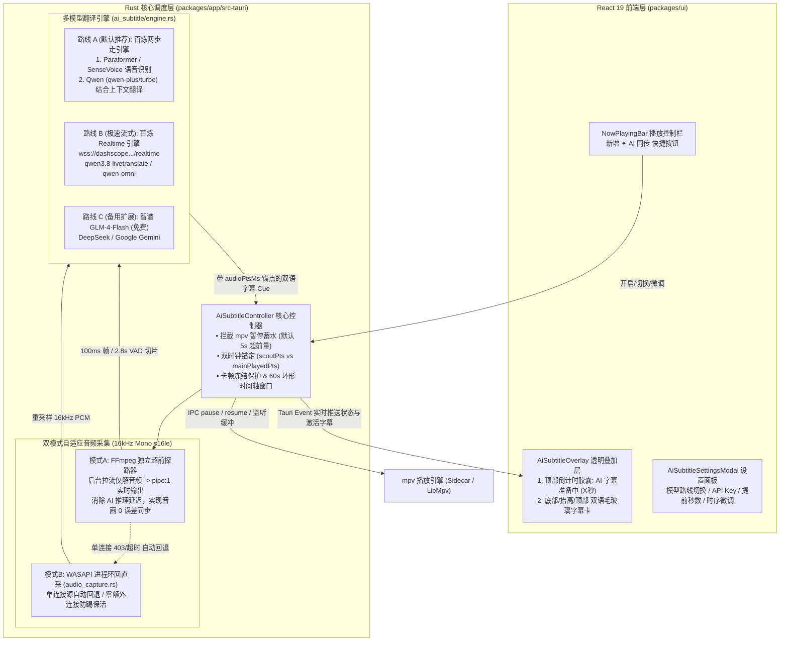

# ynoTV 桌面端 AI 实时延时同传（OwnTV+ 同款）项目计划书

> [!IMPORTANT]
> **项目目标与核心定位**
> 在 Windows 桌面端项目 [ynoTV](file:///D:/ynotv-src/README.md)（`Tauri v2 + React 19 + Rust + mpv`）中，1:1 复刻并升级你在 [OwnTV+](file:///D:/owntv+/app/src/main/java/tv/own/owntv/features/aisubtitle/AiSubtitleController.kt) 上验证成熟的 **“AI 延时直播音画同步同传翻译”** 体系。主力接入 **阿里云百炼（DashScope）** 大模型（国内直连免代理，兼顾 **两步走 Paraformer + Qwen** 与 **Realtime WebSocket 流式同传**），并向下兼容智谱 GLM（免费档备用）、DeepSeek 及 Google Gemini。

---

## 一、前期环境与代码库摸底结论

我已经完成了对 `D:\ynotv-src`（ynoTV 源码库）与 `D:\owntv+`（安卓 TV 端 AI 字幕源码）的交叉比对，发现 `ynoTV` 现有的底层设施极其契合我们的改造需求：

1. **视频透明叠加天然就绪**：
   - `ynoTV` 在 Windows 下采用 `mpv` 子窗口底层渲染 + WebView2 透明图层叠加（[tauri.conf.json](file:///D:/ynotv-src/packages/app/src-tauri/tauri.conf.json#L15-L27) 中 `"transparent": true`）。
   - **关键避坑**：`ynoTV` 在 [mpv_windows.rs](file:///D:/ynotv-src/packages/app/src-tauri/src/mpv_windows.rs#L647-L656) 和 [mpv_core.rs](file:///D:/ynotv-src/packages/app/src-tauri/src/mpv_core.rs#L595-L606) 中，每次加载新流都会强制执行 `set_property("sid", "no")` 禁用内置字幕轨以防重影。因此，我们**不走 mpv 原生 `sub-add` 字幕轨**，而是像 `OwnTV+` 一样，直接在 React 顶层挂载透明 `<AiSubtitleOverlay />` 组件！不仅彻底绕开 `sid=no` 冲突，还能完美呈现**顶部倒计时准备横幅**、**双语半透明毛玻璃卡片**与**打字机流式渐显**。
2. **双路音频采集底座齐全**：
   - **超前探路工具**：Muse 已经把 227MB 的真实 `ffmpeg.exe` 放入了 `src-tauri/bin/`，且 [dvr/recorder.rs](file:///D:/ynotv-src/packages/app/src-tauri/src/dvr/recorder.rs) 已有成熟的 FFmpeg 进程管理与重连参数构建器。
   - **单连接防踢直采底座**：`ynoTV` 的 [audio_capture.rs](file:///D:/ynotv-src/packages/app/src-tauri/src/audio_capture.rs) 已经实现了针对 `mpv.exe` PID 的 **Windows WASAPI 进程级环回采集（Process Loopback）**！这意味着当遇到限制 `Max Connections = 1` 的严苛直播源时，我们连反射 Hook 都不需要，直接从 `audio_capture.rs` 分流 `mpv` 的内存 PCM 音频并降采样到 `16kHz` 即可，100% 零额外网络连接、绝不封号踢线。
3. **手机扫码配网底座现成**：
   - [web_server.rs](file:///D:/ynotv-src/packages/app/src-tauri/src/web_server.rs) 已内置 `axum` 局域网 Web 服务器（端口 `11470`），前端也已安装 `qrcode` 依赖。我们既支持在 PC 端直接复制粘贴百炼 API Key，也支持手机扫码打开局域网配置页一键测试与下发。

---

## 二、整体系统架构设计

---

## 三、核心功能模块拆解与实现方案

### 模块 1：双模式音频采集与超前探路器 (`src-tauri/src/ai_subtitle/audio_scout.rs`)
1. **FFmpeg 独立超前探路模式（`Standalone`，默认优先）**：
   - 启动 `src-tauri/bin/ffmpeg` 子进程（Windows 下隐藏控制台窗口 `CREATE_NO_WINDOW = 0x08000000`），复用当前频道的 URL、User-Agent 与自定义 HTTP Headers。
   - 参数配置：`ffmpeg -reconnect 1 -reconnect_streamed 1 -reconnect_delay_max 5 -i <url> -vn -sn -dn -ac 1 -ar 16000 -f s16le -acodec pcm_s16le pipe:1`。
   - 异步读取 `stdout`：每 `3200 字节` 记为 `100ms` 有效音频帧，精确累加 `decoded_audio_ms`。
   - **智能断句与 VAD 静音过滤**：计算每帧 RMS 均方根能量，剔除纯静音/背景噪音段（防止大模型幻觉产生“感谢观看”等废话）；在 `2.0s ~ 3.2s` 处检测语句停顿切出完整 WAV 音频块，喂给分段识别/翻译引擎。
2. **WASAPI 内存直采回退模式（`DirectTap`，单连接源防封号）**：
   - 当 FFmpeg 探路器在 8 秒内未产出首帧音频或遇到 HTTP 403/503（单连接限制）时，自动记住该受限源并无缝回退到 [audio_capture.rs](file:///D:/ynotv-src/packages/app/src-tauri/src/audio_capture.rs) 的 WASAPI Loopback 通道，将 `mpv` 播放中的音频重采样为 `16kHz Mono PCM` 送入翻译引擎。

### 模块 2：延时直播拦截与双时钟对齐控制器 (`src-tauri/src/ai_subtitle/controller.rs`)
1. **延时蓄水拦截（复刻 VsTV / OwnTV+ 准备阶段）**：
   - 开启 AI 字幕且处于超前探路模式时，立即调用 `mpv` 的 `pause` 接口暂停主画面，向前端广播 `Preparing { seconds_left, lead_seconds }`（支持 `2s ~ 20s` 调节，默认 `9s`）。
   - 待 FFmpeg 探路器真实解码攒够 `5000ms` 超前音频（期间后台已经并发开始第一句识别与翻译）后，自动调用 `mpv` 的 `resume` 恢复主画面播放，实现**“画面开口说话的那一刻，中文字幕刚好同步弹出”**！
2. **双时钟锚定与缓冲卡顿冻结**：
   - 监听 `mpv` 的 `paused_for_cache` 与 `playing` 状态。当主画面缓冲卡顿或用户暂停时，主播放时钟 `main_played_pts_ms` **立即冻结**，屏幕字幕保持不动、绝不抢跑，并提示 `等待画面缓冲同步中…`。
3. **60 秒时间轴环形窗口与毫秒级微调**：
   - 保留最近 60 秒内所有已译出的 `AiSubtitleCue`，支持用户在播放中随时按快捷键或点击按钮进行 `-0.5s / +0.5s` 微调（范围 `-6s ~ +6s`）以及一键 **“立即对齐当前语音”**。
4. **换台（Zap）自动跟随**：
   - 监听前端换台或 `load_file` 事件，若当前已开启 AI 同传，换台后自动重置偏移量并无缝对新频道启动探路。

### 模块 3：阿里百炼双路线与多模型引擎 (`src-tauri/src/ai_subtitle/engine.rs`)
同时实现以下三条路线，你可以在设置面板里一键切换对比效果：
1. **路线 (a) 阿里百炼「两步走」引擎（Paraformer / SenseVoice 识别 + Qwen 翻译，默认稳健路线）**：
   - **第 1 步（语音识别 ASR）**：将 VAD 切出的 `2.5s ~ 3.5s` 音频块发往百炼语音识别接口（支持百炼原生 `paraformer-realtime-v2` / `fun-asr` WebSocket 或 OpenAI 兼容 `/audio/transcriptions`），秒出源语言原文，立即推送到屏幕顶部浅青色原文行显示（`is_partial = true`）。
   - **第 2 步（上下文大模型翻译）**：携带最近 2 句历史对话上下文（保证人名、体育术语、新闻背景连贯），调用百炼 `https://dashscope.aliyuncs.com/compatible-mode/v1/chat/completions`（默认 `qwen-plus` 或 `qwen-turbo`），译出地道简中字幕后原地补全下方大号加粗译文行（`is_partial = false`）。
2. **路线 (b) 阿里百炼「一步走」引擎（Qwen-Omni 多模态 / Realtime 流式同传）**：
   - 支持 **Qwen-Omni HTTP 直传**（`qwen-omni-turbo`，音频 Base64 一次调用同时输出原文+译文）以及 **百炼 Realtime WebSocket**（`qwen3.8-livetranslate-flash-realtime`，100ms 帧流式推流 + 45 秒主动无缝重连防 60 秒超时断开）。
3. **路线 (c) 免费/低成本备用模型预设**：
   - 内置 **智谱清言（`glm-asr` + `glm-4-flash` 免费档）**、**DeepSeek（`deepseek-chat`）**、**Google Gemini（`gemini-2.5-flash`）** 与 **TVGO 局域网服务** 预设。

### 模块 4：React 前端交互与透明字幕渲染 (`packages/ui/src/components/ai-subtitle/`)
1. **`AiSubtitleOverlay.tsx`（视频透明叠加层）**：
   - **准备胶囊**：画面顶部居中显示 `✦ AI 字幕准备中 · 正在提前收听并翻译，约 X 秒后开始播放`。
   - **双语字幕卡片**：支持【半透明毛玻璃卡片】与【电影透亮无框阴影】两种视觉风格；支持【标准底部】、【新闻抬高（+72px 避让底部跑马灯）】、【画面顶部（体育赛事避让底部比分）】三种位置预设及像素级上下微调。
2. **`NowPlayingBar.tsx` 快捷入口**：
   - 在底部播放控制栏原字幕按钮旁新增 **「✦ AI 同传」** 按钮（开启时呈青色呼吸高亮），左键一键开关，右键或点击设置弹出配置面板。
3. **`AiSubtitleSettingsModal.tsx`（配置与连通性测试弹窗）**：
   - 提供服务商一键预设切换（阿里百炼两步走 / 阿里百炼一步走 / 智谱免费档 / Gemini 等）。
   - 提供 API Key 密码框（本地安全持久化，支持调用 Rust `keyring` 系统凭据保险箱或本地配置存储）及 **「一键测试连通性」** 按钮（直观返回 HTTP/WebSocket 握手耗时与报错诊断）。
   - 提供二维码扫码面板（复用 `web_server.rs` 局域网服务），方便从手机端直接粘贴 Key。

---

## 四、分阶段实施排期（共 4 个阶段）

| 阶段 | 任务模块 | 涉及核心文件 | 验收标准 |
| :--- | :--- | :--- | :--- |
| **Phase 1** | **Rust 后端配置存储与多模型翻译引擎** | `src-tauri/src/ai_subtitle/mod.rs` `src-tauri/src/ai_subtitle/config.rs` `src-tauri/src/ai_subtitle/engine.rs` | 完成百炼两步走（ASR + Qwen）、百炼一步走（Qwen-Omni / Realtime WS）及智谱预设的协议封装与「一键连通性测试」Tauri 命令，`cargo check` 零报错通过。 |
| **Phase 2** | **FFmpeg 超前探路 + WASAPI 直采 + 双时钟控制器** | `src-tauri/src/ai_subtitle/audio_scout.rs` `src-tauri/src/ai_subtitle/controller.rs` `src-tauri/src/audio_capture.rs` | 实现 FFmpeg 后台 16kHz PCM 探路、mpv 暂停蓄水 5 秒倒计时、恢复播放双时钟对齐，以及单连接源自动回退 WASAPI Loopback。 |
| **Phase 3** | **React 透明字幕叠加层与控制栏 UI 集成** | `packages/ui/src/components/ai-subtitle/AiSubtitleOverlay.tsx` `packages/ui/src/components/ai-subtitle/AiSubtitleModal.tsx` `packages/ui/src/components/NowPlayingBar.tsx` | 播放栏出现 `✦ AI 同传` 按钮，顶部倒计时胶囊与底部双语毛玻璃字幕正常渲染，支持字号、位置（底部/新闻抬高/顶部）与 `-10s~+15s` 微调。 |
| **Phase 4** | **真机直播流联调与打包验证** | `D:\ynotv-src` 全链路联调 | 填入百炼 API Key 后，实测英文/外语直播流：5 秒延时准备后音画精准同步出双语字幕，换台自动重连，缓冲卡顿字幕不抢跑。 |

---

## 五、当前已为你补充的专属 Skill

为了让我在后续写代码和排错时始终遵循 `ynoTV` 与 `OwnTV+` 的架构规范，我已经自动为你创建并挂载了专属开发技能：
- **全局与项目级 Skill**：[ynotv-tauri-ai-subtitle](file:///C:/Users/Penn/.gemini/config/skills/ynotv-tauri-ai-subtitle/SKILL.md)（同时写入了 [D:\ynotv-src\.agents\skills\ynotv-tauri-ai-subtitle\SKILL.md](file:///D:/ynotv-src/.agents/skills/ynotv-tauri-ai-subtitle/SKILL.md)）
- **涵盖内容**：`ynoTV` 的 Monorepo 启动铁律（`pnpm --filter @ynotv/app tauri dev`）、6 个必备二进制/DLL 清单、mpv `sid=no` 透明图层避坑指南、FFmpeg 超前探路参数、WASAPI 进程环回直采回退机制、以及阿里百炼 API 协议细节。
